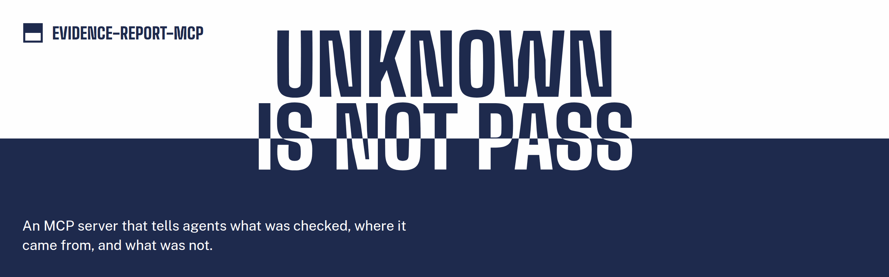

# evidence-report-mcp

<picture>
  <source media="(prefers-color-scheme: dark)" srcset="./docs/public/logo/banner-dark.png">
  
</picture>

[](./CONTRIBUTING.md)
[](https://semver.org/spec/v2.0.0.html)
[](https://www.npmjs.com/package/evidence-report-mcp)
[](https://github.com/phun-ky/evidence-report-mcp/issues)
[](./LICENSE)
[](https://www.npmjs.com/package/evidence-report-mcp)
[](https://github.com/phun-ky/evidence-report-mcp)
[](https://github.com/phun-ky/evidence-report-mcp/actions/workflows/check.yml)
[](https://www.bestpractices.dev/projects/16929)
[](https://scorecard.dev/viewer/?uri=github.com/phun-ky/evidence-report-mcp)

A "trust layer" MCP server: one `verify` tool an agent calls _before_ acting on
data it did not produce, such as a package, a dataset, a media file or a claim.
It returns an evidence report, not a checkmark: what was checked, where each
result came from and when, and what was not checked.

Companion to the talk
[_Invisible Data: Building Trust in the Age of AI_](https://slides.com/phun-ky/invisible-data-building-trust-in-the-age-of-ai).

**Documentation:**
[phun-ky.net/evidence-report-mcp](https://phun-ky.net/evidence-report-mcp/)

## Getting started

Needs Node.js 22.12.0 or later. Add it to Claude Code:

```sh
claude mcp add evidence-report -- npx -y evidence-report-mcp
```

Then ask your agent to verify before it acts, for example: "Before you add
lodash 4.17.20, verify it, and tell me what was not checked." The answer is an
evidence report:

```json
{
  "verdict": "fail",
  "summary": "Failed: 1/1 checks completed, 4 finding(s).",
  "checks": [
    {
      "id": "osv.vulnerabilities",
      "status": "fail",
      "source": {
        "name": "OSV.dev",
        "retrievedAt": "2026-11-19T11:17:18.524Z"
      },
      "findings": [
        {
          "severity": "high",
          "message": "Command Injection in lodash",
          "ref": "GHSA-35jh-r3h4-6jhm"
        }
      ]
    }
  ],
  "notChecked": ["Unpublished or zero-day vulnerabilities", "..."]
}
```

A verdict of `unknown` means not verified, never safe.

The package also works without MCP, and exports the report's types:

```ts
import { verify, type EvidenceReport } from 'evidence-report-mcp';

const report: EvidenceReport = await verify({
  kind: 'package',
  ecosystem: 'npm',
  name: 'lodash',
  version: '4.17.20'
});

console.log(report.verdict); // fail
console.log(report.summary); // Failed: 1/1 checks completed, 4 finding(s).
```

## Learn more

- [Getting started](https://phun-ky.net/evidence-report-mcp/guide/), including
  other MCP clients
- [The evidence report](https://phun-ky.net/evidence-report-mcp/guide/report):
  every field, and how the verdict is worked out
- The checks:
  [packages](https://phun-ky.net/evidence-report-mcp/guide/checks/package),
  [datasets](https://phun-ky.net/evidence-report-mcp/guide/checks/dataset),
  [media files](https://phun-ky.net/evidence-report-mcp/guide/checks/file) and
  [claims](https://phun-ky.net/evidence-report-mcp/guide/checks/claim)
- [Configuration](https://phun-ky.net/evidence-report-mcp/guide/configuration),
  including `c2patool` for media files
- [API reference](https://phun-ky.net/evidence-report-mcp/api/)
- [Security policy](./SECURITY.md) and [assurance case](./ASSURANCE.md)
- [Contributing](./CONTRIBUTING.md), [governance](./GOVERNANCE.md),
  [roadmap](./ROADMAP.md) and [Code of Conduct](./CODE_OF_CONDUCT.md)

## Licence

[MIT](./LICENSE)
